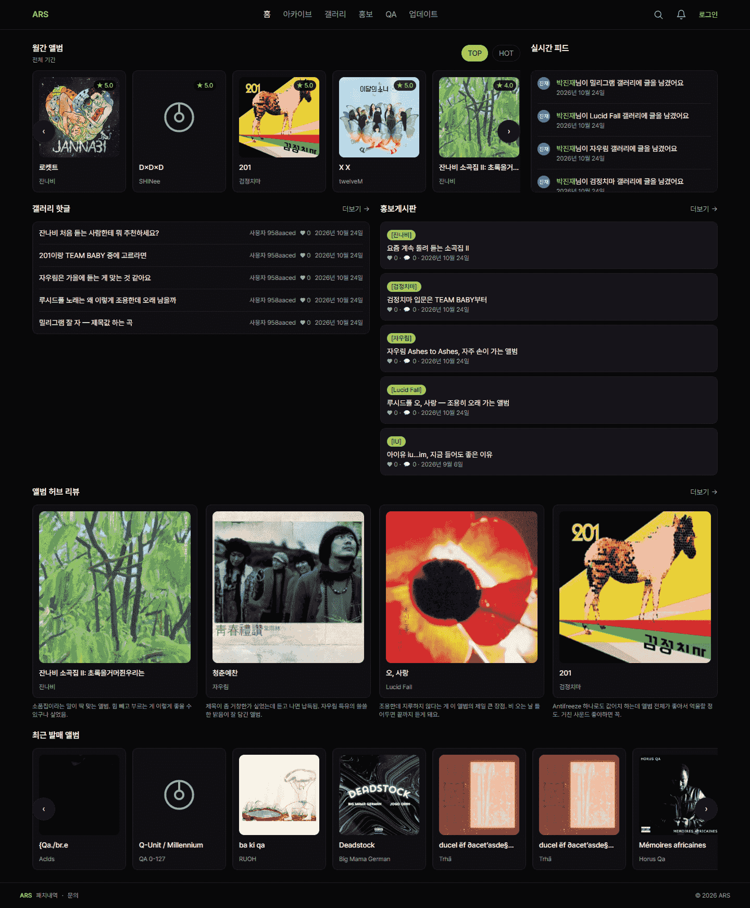
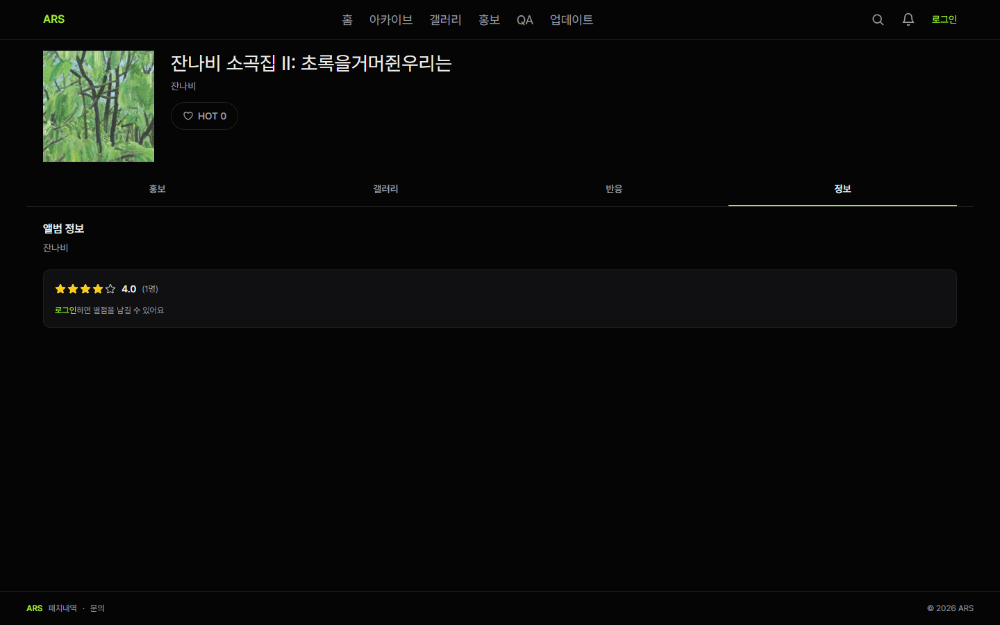
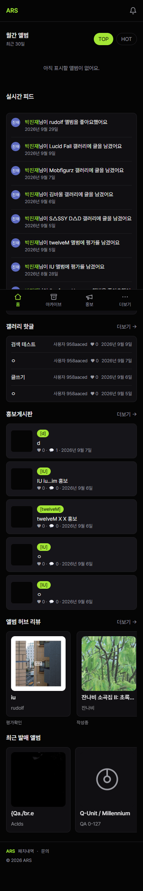

# ARS (Album Review Service)

> 리스너는 즐길 수 있고, 아티스트는 홍보를 할 수 있는 음악 커뮤니티

**🔗 Live: https://ars-eta-one.vercel.app**

---

## 스크린샷

| 홈 (1440) | 앨범 허브 (1440) |
|---|---|
|  |  |

<details>
<summary>모바일 홈 (375)</summary>



</details>

## 이런 서비스입니다

MusicBrainz에서 앨범을 검색해 아카이브에 모으고, 앨범마다 "허브" 페이지를 두어 그 앨범에 달린 홍보글·갤러리·반응·정보를 한곳에서 볼 수 있게 했습니다. 원래는 평점·코멘트 중심의 앨범 평가 앱으로 시작했지만, 평점을 정보 탭 하나로 내리고(#71) 앨범을 매개로 한 게시판·팔로우 중심 커뮤니티로 방향을 바꿨습니다.

## 핵심 기능

- **앨범 아카이브** — MusicBrainz API로 앨범 검색, 아카이브 목록/필터(아티스트·평점·정렬)
- **앨범 허브** — 앨범별 홍보/갤러리/반응/정보 4개 탭(`HubTabs`)
- **커뮤니티 게시판** — 홍보·갤러리·QA·업데이트 4종 게시판 글쓰기/열람/수정·삭제(본인 글), 댓글·좋아요·공유
- **소셜** — 공개 프로필, 팔로우/언팔로우, 좋아요(앨범/댓글/게시글 공통)
- **관리자 role** — 업데이트 게시판 글쓰기와 갤러리 공지는 `is_admin`만. UI 숨김이 아니라 RLS `WITH CHECK`로 DB에서 차단(#125)
- **랭킹** — 홈 화면 HOT 앨범에만 적용(앨범 좋아요 순)

## 기술 스택

| 영역 | 기술 |
|------|------|
| Frontend | Next.js 16 (App Router), TypeScript, Tailwind CSS 4, React 19 |
| Backend/DB | Supabase (PostgreSQL, RLS, Auth) |
| 외부 API | MusicBrainz, Cover Art Archive |
| 테스트 | Vitest(단위 49개), Playwright(E2E 17개 — 로컬 `next build` + `next start` 대상) |
| 배포 | Vercel |

## 한번 막힌 지점

### 1. 더미 라우팅 식별자 감별

레이아웃 단계에서 넣은 더미 라우팅 식별자(`mbid-1` 류)가 실제 클릭 시 404로 이어지는 문제가 세 번 재발했습니다(#49 → #96 → #108). 세 번째 재발 후에는 개별 수정 대신, 동적 라우트에서 UUID/mbid 형식이 아니면 DB 조회 전에 걸러내는 가드를 넣고 CLAUDE.md에 "라우팅에 쓰이는 식별자는 더미여도 가짜 값 금지" 규칙으로 못박았습니다(#109/#112).

### 2. 타입이 맞다고 해도 런타임을 의심함

- Supabase 쿼리는 실패해도 throw하지 않고 `{ data, error }`를 반환합니다. `error`를 확인하지 않으면 조회 실패와 "결과 0건"이 구분되지 않아, 화면엔 그냥 빈 목록으로 보였습니다(#105/#106에서 `error` 필드 명시 체크로 수정).
- `artists(name)` 같은 to-one FK embed를 supabase-js 기본 타입 추론이 배열로 잡는데, 실제 REST 응답은 단일 객체였습니다. 타입만 믿었으면 팀 이름이 항상 `null`로 나오는 조용한 버그가 났을 자리라 curl로 실제 응답을 직접 확인하고 타입을 맞췄습니다(#103).

### 3. 단순 평가 -> 커뮤니티로 피벗

초기엔 평점(0.5 단위)·코멘트가 핵심이었지만, 앨범을 중심으로 활동이 모이는 아카이브/커뮤니티 쪽이 더 맞다고 판단해 평점을 앨범 상세의 정보 탭 하나로 내리고 마이페이지를 프로필로 흡수했습니다(#71).

### 4. RLS는 `USING`만으로 끝나지 않고, `WITH CHECK`로도 끝나지 않았음

업데이트 게시판은 "글쓰기 버튼을 숨겼으니 관리자 전용"이라고 적혀 있었지만, 비관리자 JWT로 REST를 직접 호출해 보니 `updates` 글 생성과 본인 `qa` 글의 `board_type` 전환이 그대로 통과했습니다. 원인은 UPDATE 정책에 `USING`만 있어 신규 행 검사까지 `USING`이 겸하고 있던 것. 정책을 `WITH CHECK`가 있는 것으로 **교체**했습니다(같은 cmd의 PERMISSIVE 정책은 OR로 합쳐져, 느슨한 정책을 남긴 채 엄격한 정책을 추가해도 안 막힘 — #125/020). 그런데 `WITH CHECK`는 새 값만 볼 뿐 OLD 행을 못 보기 때문에 "`qa ↔ promo` 전환 금지" 같은 컬럼 불변은 여전히 못 막았고, 이건 `BEFORE UPDATE OF <컬럼>` + `WHEN (OLD IS DISTINCT FROM NEW)` 트리거로 내렸습니다(#43/021). 세 단계 모두 "막힌 것 같다"가 아니라 뚫림을 먼저 재현(트랜잭션 롤백)한 뒤 차단 확인과 일반 유저 회귀까지 보는 순서로 진행했습니다.

## 로컬 실행

```bash
git clone https://github.com/Zpark99/ARS.git
cd ARS-web
npm install
npm run dev
```

`.env.local`에 아래 환경변수가 필요합니다 (값은 Supabase 프로젝트 설정에서 확인):

```
NEXT_PUBLIC_SUPABASE_URL=
NEXT_PUBLIC_SUPABASE_ANON_KEY=
```

```bash
npm run lint       # ESLint
npm run test       # Vitest
npm run build      # 프로덕션 빌드
npm run test:e2e   # Playwright (별도 .env.test에 테스트 계정 필요, 빌드 후 :3100에서 실행)
```

## 프로젝트 구조

```
src/
├─ app/                # 라우트 (App Router)
│  ├─ album/[mbid]/     # 앨범 허브
│  ├─ archive/          # 아카이브
│  ├─ gallery/, promo/, qa/, updates/   # 게시판 4종 (목록 + [postId] 상세)
│  ├─ profile/[id]/, ranking/, search/, notifications/
│  ├─ api/              # search, likes, follows, ratings, comments
│  └─ icon.tsx, apple-icon.tsx, opengraph-image.tsx   # 파비콘·OG (#196)
├─ components/          # album, board, cards, gallery, home, layout, promo, profile, ui 등
├─ lib/
│  ├─ supabase/         # client.ts, server.ts
│  ├─ likes/, validation/, brand.ts, seo.ts
└─ hooks/, types/
e2e/                     # Playwright 시나리오 (anon.spec / user.spec)
supabase/migrations/     # 스키마 변경 이력 000~021 (DB 직접 수정 금지, 파일로만)
```

## 알려진 제한

현재 배포본 기준으로 "있어 보이지만 실제로는 안 되는 것"을 숨기지 않고 적어둡니다. 저장이 안 되는 기능은 거짓 성공 대신 "준비 중"으로 표시합니다.

- 목록 "더 보기"는 비활성 플레이스홀더 — 페이지네이션 없음 (#155)
- 앨범 등록 요청 모달·갤러리 구독 버튼은 "준비 중" 표시만, 저장 안 됨 (#156 / 구독은 추적 이슈 없음)
- 알림은 빈 상태 스텁 (#128), 조회수 없음 (#123), 갤러리 이미지 업로드 없음 (#124)
- `albums.artist_name` ↔ `artists` 매칭 갭 22% — 일부 앨범이 팀 갤러리와 이어지지 않음 (#101)
- 홈 "최근 발매"는 발매일 컬럼이 없어 DB 등록일 기준 (#130)
- 다크 단일 테마 — 라이트 토큰 없음
- dev/prod가 단일 Supabase 프로젝트 — 마이그레이션은 적용 즉시 프로덕션 반영. E2E는 로컬 전용, CI 없음
- 관리자 지정은 Supabase 콘솔에서 `is_admin` 수동 UPDATE (코드 경로 없음)

## 로드맵 (v1.1)

아직 스키마나 실기능이 없어 의도적으로 보류한 항목입니다. 열린 이슈(`차기 - v1.1` 마일스톤 15건) 기준.

단순기능
- 알림 실기능 (발생/목록/읽음 처리) — #128
- 목록 페이지네이션(키셋 커서) — 현재 "더 보기"는 비활성 플레이스홀더 — #155
- 도메인 구매 (이슈 없음)

아카이브
- API 수정 -> 장르, 연도별 앨범 구분 — #130
- 앨범 등록 요청 저장 연결(현재 모달은 "준비 중" 안내만) — #156
- albums 중복 행 재발 방지 — mbid 기준 upsert — #117

게시판
- 갤러리 이미지 업로드(Storage 연동) — #124
- API 데이터 수정(MusicBrainz는 들어오는 유저의 정서와 다소 떨어짐) — 검토 결론: 교체 없이 커버·메타 보강 레이어, 소스는 Apple(iTunes Search API)(#151 · 2026-10-11, Spotify 안 대체) — #151
- `albums.artist_name` ↔ `artists` 자동 동기화 (현재 매칭 갭 22%) — #101
- 게시판 안내 기능 살리기(신고, 공지사항, 신설 갤러리 요청, 자주 묻는 질문, 이용 규칙) — #152
- 갤러리 개념글 좋아요순 정렬 — #126 · 전체 탭 공지 상단 고정 — #175
- 조회수 카운팅 — #123

그 외
- 마감-2 진단 잔여(max-w 토큰화·카드 크기 통일·워드마크·터치 영역·앨범별 OG) — #198
- 021 트리거와 중복되는 수동 정리 코드 제거 — #176
- Supabase 보안/성능 어드바이저 WARN 정리 — #134
