# 03. ERD — 실제 배포 스키마 기준

> 이 문서는 "계획"이 아니라 **현재 라이브 DB(Supabase 프로젝트 `ARS`, `swjzbmpymrzrmrafkfnl`)의 실제 스키마**를 반영합니다.
> 모든 테이블·컬럼·제약·인덱스·RLS는 `information_schema` / `pg_policies` / `pg_indexes` / `pg_trigger`를 직접 조회해 확인한 값입니다.
> 기획 시점 문서(Notion "03. ERD.md" v0.3, 2026-08-26)는 Spotify 연동·`posts` 통합 테이블·`notifications`/`album_requests` 등을 전제로 했으나, 실제 구현은 방향이 달라졌습니다. 5장에 델타를 정리했습니다.

---

## 0. 문서 정보

| 항목 | 내용 |
|---|---|
| 문서 버전 | v1.0 (배포판, 라이브 DB 기준) |
| 작성일 | 2026-09-10 |
| DB | Supabase (PostgreSQL 17, RLS) |
| 앨범/아티스트 출처 | **MusicBrainz + Cover Art Archive** (Spotify 아님 — 기획 초기 계획에서 전환) |

| 버전 | 날짜 | 변경 내용 |
|---|---|---|
| v0.1~v0.3 (기획) | 2026-08-11 ~ 08-26 | Notion에서 관리. Spotify 연동, `posts` 통합, `notifications`/`album_requests` 등을 전제로 설계 |
| v1.0 (본 문서) | 2026-09-10 | 라이브 DB 전수 조회 기준으로 전면 재작성. 레포(`docs/03_ERD.md`)로 이관 |
| v1.0.1 | 2026-09-24 | `album_requests` 관리자 확인 = Supabase 콘솔 수동 결정 반영 (#153) |

---

## 1. 엔티티 개요

실제 `public` 스키마에 존재하는 테이블/뷰만 기재합니다. 기획에만 있고 미구현인 것은 표에서 빼고 9장 로드맵에 남깁니다.

| 테이블 | 역할 |
|---|---|
| `profiles` | 공개 프로필 (`auth.users`와 1:1) |
| `artists` | 아티스트/팀. 갤러리 기능을 흡수한 단일 엔티티 |
| `albums` | 앨범 카탈로그 (MusicBrainz `mbid` 기준) |
| `board_posts` | 게시판 통합 테이블 — `board_type`으로 `qa`/`updates`/`promo` 3종만 분기 (**`gallery`는 여기 없음**) |
| `gallery_posts` | 갤러리 글. `board_posts`와 완전히 분리된 별도 테이블 |
| `comments` | 댓글 (다형성: `target_type` ∈ `album`/`post`) |
| `likes` | 좋아요 (다형성: `target_type` ∈ `album`/`comment`/`post`) |
| `follows` | 유저→유저 팔로우 |
| `gallery_subscriptions` | 유저→아티스트(갤러리) 구독 |
| `ratings` | 평점 (앨범 상세 부가 정보로 강등, #71) |
| `popular_albums` (VIEW) | 평점 개수·평균 기준 인기 앨범 |
| `monthly_artists` (VIEW) | 이달 평점이 달린 아티스트 집계 |

> `galleries` 테이블은 애초에 존재한 적이 없습니다(마이그레이션 012 주석 확인). "폐기"가 아니라 처음부터 `artists`가 갤러리 역할을 겸했습니다.

---

## 2. ERD 다이어그램

```mermaid
erDiagram
  auth_users ||--o| profiles : "1:1, 가입 트리거"
  auth_users ||--o{ ratings : rates
  auth_users ||--o{ comments : writes
  auth_users ||--o{ likes : gives
  auth_users ||--o{ follows : follower
  auth_users ||--o{ follows : following
  auth_users ||--o{ board_posts : writes
  auth_users ||--o{ gallery_posts : writes
  auth_users ||--o{ gallery_subscriptions : subscribes

  albums ||--o{ ratings : rated_in
  albums ||--o{ board_posts : "연결(promo, 선택)"
  artists ||--o{ board_posts : "연결(promo, 선택)"
  artists ||--o{ gallery_posts : "소속(선택)"
  artists ||--o{ gallery_subscriptions : "구독 대상"

  auth_users {
    uuid id PK "Supabase Auth 관리"
  }
  profiles {
    uuid id PK "= auth.users.id"
    text nickname "NOT NULL default ''"
    text avatar_url "nullable"
    text bio "NOT NULL default ''"
    timestamptz created_at
  }
  artists {
    uuid id PK
    text name UK
    text gallery_description "nullable"
    int post_count "default 0"
    int subscriber_count "default 0"
    bool is_gallery_open "default true"
    timestamptz created_at
  }
  albums {
    uuid id PK
    text mbid UK "MusicBrainz ID"
    text title
    text artist_name "자유 텍스트, artists FK 아님"
    text cover_url "nullable"
    int like_count "default 0"
    timestamptz created_at
  }
  board_posts {
    uuid id PK
    uuid user_id FK
    text board_type "qa | updates | promo"
    uuid artist_id FK "nullable"
    uuid album_id FK "nullable"
    text artist_name_text "nullable, 팀 수기 입력(#116)"
    text title
    text content
    int like_count "default 0"
    timestamptz created_at
    timestamptz updated_at
  }
  gallery_posts {
    uuid id PK
    uuid user_id FK
    uuid artist_id FK "nullable"
    text artist_name "자유 텍스트(레거시)"
    text title
    text content
    text post_flag "notice | concept | normal"
    timestamptz created_at
    timestamptz updated_at
  }
  comments {
    uuid id PK
    uuid user_id FK
    text target_type "album | post"
    uuid target_id "폴리모픽, FK 아님"
    text content
    timestamptz created_at
  }
  likes {
    uuid id PK
    uuid user_id FK
    text target_type "album | comment | post"
    uuid target_id "폴리모픽, FK 아님"
    timestamptz created_at
  }
  follows {
    uuid id PK
    uuid follower_id FK
    uuid following_id FK
    timestamptz created_at
  }
  gallery_subscriptions {
    uuid user_id PK "복합 PK, FK→auth.users"
    uuid artist_id PK "복합 PK, FK→artists"
    timestamptz created_at
  }
  ratings {
    uuid id PK
    uuid user_id FK
    uuid album_id FK
    numeric score "0.5~5.0, 0.5 단위 CHECK"
    timestamptz created_at
  }
```

> **폴리모픽 주의**: `comments.target_id` / `likes.target_id`는 실제 FK 제약이 없습니다(대상 테이블이 `album`/`post`/`comment`로 갈리기 때문). 위 다이어그램에서도 실선 FK로 그리지 않았습니다 — 애플리케이션 레벨에서만 무결성을 보장합니다.
> **`albums.artist_name`은 `artists`를 가리키는 FK가 아니라 자유 텍스트**입니다. `board_posts`/`gallery_posts`가 `artists.id`로 팀을 연결하는 것과 다른 경로라, 두 값이 어긋나는 경우가 실측 22%입니다(#101, 9장 로드맵).

---

## 3. 테이블 상세

### 3.1 `profiles`
`auth.users` 1:1. `handle_new_user()` 트리거(auth.users AFTER INSERT)로 자동 생성.

| 컬럼 | 타입 | 제약 |
|---|---|---|
| id | uuid | PK, FK→auth.users(id) |
| nickname | text | NOT NULL, default `''` |
| avatar_url | text | nullable |
| bio | text | NOT NULL, default `''` |
| created_at | timestamptz | default now() |

> 기획 문서의 `username`(UNIQUE)·`is_admin` 컬럼은 **실제로 존재하지 않습니다**. 닉네임 중복 제약 없음, role/관리자 권한 체계 자체가 없음(#125, 로드맵).

### 3.2 `artists`

| 컬럼 | 타입 | 제약 |
|---|---|---|
| id | uuid | PK |
| name | text | UNIQUE, NOT NULL |
| gallery_description | text | nullable |
| post_count | int | NOT NULL, default 0 |
| subscriber_count | int | NOT NULL, default 0 |
| is_gallery_open | bool | NOT NULL, default true |
| created_at | timestamptz | default now() |

> 기획 문서의 `spotify_id`/`source`/`is_verified`/`image_url`은 **존재하지 않습니다** — Spotify 연동 자체가 폐기되고 MusicBrainz 기반으로 갔기 때문입니다. RLS도 `SELECT`만 공개 정책이 있고 INSERT/UPDATE 정책이 없어(관리자 보정 기능 없음), 현재는 애플리케이션에서 신규 아티스트 행을 만드는 별도 쓰기 경로가 없는 상태입니다(관련 코드 경로는 이번 조사에서 확인하지 않음 — [확인 필요]).

### 3.3 `albums`

| 컬럼 | 타입 | 제약 |
|---|---|---|
| id | uuid | PK |
| mbid | text | UNIQUE, NOT NULL |
| title | text | NOT NULL |
| artist_name | text | NOT NULL, **자유 텍스트** (artists FK 아님) |
| cover_url | text | nullable |
| like_count | int | NOT NULL, default 0 |
| created_at | timestamptz | default now() |

> `spotify_id`/`source`/`is_verified`/`artist_id`(FK)/`release_date` 전부 없음. 장르·발매연도 필터가 안 되는 이유(#130)는 애초에 해당 컬럼이 없기 때문입니다.

### 3.4 `board_posts`
QA·업데이트·홍보 3종 통합. **갤러리는 여기 없습니다** — `gallery_posts`가 완전히 별도 테이블입니다.

| 컬럼 | 타입 | 제약 |
|---|---|---|
| id | uuid | PK |
| user_id | uuid | NOT NULL, FK→auth.users |
| board_type | text | NOT NULL, CHECK ∈ `qa`,`updates`,`promo` |
| title | text | CHECK 1~100자 |
| content | text | CHECK 1~2000자 |
| like_count | int | default 0 |
| artist_id | uuid | nullable, FK→artists |
| album_id | uuid | nullable, FK→albums |
| artist_name_text | text | nullable — 팀 수기 입력(#116) |
| created_at / updated_at | timestamptz | default now() |

CHECK 제약:
- `board_posts_promo_requires_artist_or_text`: `board_type <> 'promo' OR (artist_id IS NOT NULL OR artist_name_text IS NOT NULL)` — promo 글은 `artist_id` **또는** `artist_name_text` 중 하나는 있어야 함(#116). `album_id`는 여전히 완전 선택.

> 기획 문서는 013(promo 필수 연결) → 014(자유화, 필수 제거)까지만 반영했지만, 실제로는 **016에서 다시 "팀 연결 필수(단, 수기 입력도 허용)"로 되돌아갔습니다.** 완전 자유화 상태가 아닙니다.

### 3.5 `gallery_posts`

| 컬럼 | 타입 | 제약 |
|---|---|---|
| id | uuid | PK |
| user_id | uuid | NOT NULL, FK→auth.users |
| artist_id | uuid | nullable, FK→artists |
| artist_name | text | NOT NULL (레거시 자유 텍스트, `artist_id`로 대체 진행 중으로 추정 — [확인 필요]) |
| title | text | CHECK ≤100자 |
| content | text | CHECK ≤2000자 |
| post_flag | text | NOT NULL, default `normal`, CHECK ∈ `notice`,`concept`,`normal` |
| created_at / updated_at | timestamptz | default now() |

> 좋아요 스키마 없음 — `likes.target_type`에 gallery_posts용 값이 없어 갤러리 글은 좋아요 카운트가 항상 0 (#104, 로드맵).

### 3.6 `comments` (다형성)

| 컬럼 | 타입 | 제약 |
|---|---|---|
| id | uuid | PK |
| user_id | uuid | NOT NULL, FK→auth.users |
| target_type | text | NOT NULL, CHECK ∈ `album`,`post` |
| target_id | uuid | NOT NULL, FK 없음(폴리모픽) |
| content | text | CHECK ≤500자 |
| created_at | timestamptz | default now() |

> `target_type`에 `comment`가 없어 대댓글(답글의 답글)은 스키마상 불가 — 기획 문서 v0.1의 "평면 댓글 권장" 결정과 일치.

### 3.7 `likes` (다형성)

| 컬럼 | 타입 | 제약 |
|---|---|---|
| id | uuid | PK |
| user_id | uuid | NOT NULL, FK→auth.users |
| target_type | text | NOT NULL, CHECK ∈ `album`,`comment`,`post` |
| target_id | uuid | NOT NULL, FK 없음(폴리모픽) |
| created_at | timestamptz | default now() |

UNIQUE(`user_id`,`target_type`,`target_id`) — 동시성 대응(`ON CONFLICT DO NOTHING`).
`sync_like_count()` 트리거(likes AFTER INSERT/DELETE)가 `albums.like_count`/`board_posts.like_count`를 캐시 컬럼으로 원자적 증감(#36).

### 3.8 `follows`

| 컬럼 | 타입 | 제약 |
|---|---|---|
| id | uuid | PK |
| follower_id | uuid | NOT NULL, FK→auth.users |
| following_id | uuid | NOT NULL, FK→auth.users |
| created_at | timestamptz | default now() |

UNIQUE(`follower_id`,`following_id`) + CHECK `follower_id <> following_id`(자기 팔로우 금지).

### 3.9 `gallery_subscriptions`

| 컬럼 | 타입 | 제약 |
|---|---|---|
| user_id | uuid | PK(복합), FK→auth.users |
| artist_id | uuid | PK(복합), FK→artists |
| created_at | timestamptz | default now() |

### 3.10 `ratings`

| 컬럼 | 타입 | 제약 |
|---|---|---|
| id | uuid | PK |
| user_id | uuid | NOT NULL, FK→auth.users |
| album_id | uuid | NOT NULL, FK→albums |
| score | numeric | CHECK `0.5 ≤ score ≤ 5` AND `score*2`가 정수(0.5 단위) |
| created_at | timestamptz | default now() |

UNIQUE(`user_id`,`album_id`). UPDATE 정책에 `WITH CHECK(auth.uid() = user_id)`가 있어 소유권 이전(다른 유저로 `user_id` 변경) 차단.

---

## 4. 집계 뷰

기획 문서의 `monthly_ranking`이라는 이름의 뷰는 존재하지 않습니다. 실제로는 뷰 2개입니다.

- **`popular_albums`**: `albums` LEFT JOIN `ratings`, 앨범별 `rating_count`/`avg_score` 집계, 평점 1개 이상인 앨범만, `rating_count DESC, avg_score DESC` 정렬.
- **`monthly_artists`**: `albums` JOIN `ratings` (이번 달 생성된 평점만), 아티스트명(`artist_name`, 자유 텍스트) 기준 집계.

---

## 5. DB 델타 — 기획(Notion v0.3, 2026-08-26) vs 실제 배포 스키마

| 항목 | 문서 주장 | 실제 DB | 판정 |
|---|---|---|---|
| 게시글 구조 | `posts` 단일 통합 테이블 (board_type: gallery/promo/qa/update) | `board_posts`(qa/updates/promo) + `gallery_posts` 완전 분리 테이블 2개 | **수정** — 통합 안 됨 |
| 갤러리 흡수 | `galleries` 폐기 → `artists`가 흡수 | `artists`에 `gallery_description`/`post_count`/`subscriber_count`/`is_gallery_open` 실재. `galleries` 테이블은 애초에 없었음(폐기가 아니라 무존재) | **일치(용어만 정정)** |
| 앨범/아티스트 출처 | Spotify API 임포트 (`spotify_id`, `source`, `is_verified`) | MusicBrainz `mbid` 기준. `spotify_id`/`source`/`is_verified` 컬럼 전부 없음 | **삭제/전면 수정** |
| `album_requests` | 앨범 등록 요청 테이블 (신규 계획) | 테이블 없음. 요청 모달(`AlbumRequestModal`)은 insert 없는 더미 제출 | **보류(폐기 아님)** — 관리자 확인은 콘솔 수동으로 확정, 9장 참조 |
| `notifications` | 알림 테이블 (신규 계획) | 테이블 없음. `/notifications` 라우트는 있으나 빈 상태만 렌더하는 스텁 | **로드맵 이동** (#128) |
| `monthly_ranking` (VIEW) | 월간 TOP/HOT 통합 뷰 | 이름 다름 + 2개로 분리: `popular_albums`(전체 인기), `monthly_artists`(이달 아티스트) | **수정** |
| `profiles.username`/`is_admin` | UNIQUE username, is_admin 관리자 플래그 | 컬럼명은 `nickname`(UNIQUE 아님), `is_admin` 컬럼 자체 없음 | **수정** |
| `board_posts.artist_name_text` | 문서에 없음(v0.3 이후 변경) | 실재(#116, promo 팀 수기 입력) | **추가 반영 필요** |
| promo 팀 연결 필수 여부 | 014에서 필수 CHECK 제거 → 완전 자유 | 016에서 "artist_id 또는 artist_name_text 필수"로 재도입 | **수정** — 완전 자유화 아님 |
| `idx_board_posts_promo_album` | 문서에 없음 | 실재(#100, promo+album_id 부분 인덱스) | **추가 반영 필요** |
| `albums.artist_name` ↔ `artists` | 문서상 `albums.artist_id` FK로 연결 | 실제로는 `artists` FK 없이 자유 텍스트. 자동 동기화 없어 매칭 갭 22%(#101) | **수정** — 설계와 다른 경로 |
| `likes` target_type | `post`/`comment`/`album` | 동일(`album`/`comment`/`post`) | **일치** |
| `ratings` | UNIQUE(user_id,album_id), score numeric | 동일 + 0.5 단위 CHECK, UPDATE 소유권 이전 차단 정책까지 실재 | **일치(세부 보강)** |
| `follows` PK | 복합 PK(follower_id, following_id) | surrogate `id` PK + UNIQUE(follower_id, following_id) 조합, 자기팔로우 금지 CHECK | **소폭 수정** |

---

## 6. RLS 정책 (실측)

| 테이블 | SELECT | INSERT | UPDATE | DELETE |
|---|---|---|---|---|
| albums | 공개(anon) | 로그인 유저 전체 허용 | 없음 | 없음 |
| artists | 공개(anon) | 없음 | 없음 | 없음 |
| board_posts | 공개(anon) | 본인만(`auth.uid()=user_id`) | 본인만 | 본인만 |
| gallery_posts | 공개(anon) | 본인만 | 본인만 | 본인만 |
| comments | 공개(anon) | 본인만 | 없음 | 본인만 |
| likes | 공개(anon) | 본인만 | 없음 | 본인만 |
| follows | 공개(anon) | 본인만(`follower_id`) | 없음 | 본인만 |
| gallery_subscriptions | **본인만**(공개 아님) | 본인만 | 없음 | 본인만 |
| profiles | 공개(anon) | 없음(트리거로만 생성) | 본인만 | 없음 |
| ratings | 공개(anon) | 본인만 | 본인만(+WITH CHECK 소유권 이전 차단) | 본인만 |

> 기획 문서가 말한 "관리자만 쓰기"(`is_admin` 기반 artists 보정, update 게시판 관리자 전용) 정책은 **실제로 없습니다** — role 체계 자체가 없어(#125) 관리자 전용 쓰기 정책도 존재하지 않습니다.

---

## 7. 인덱스 (실측)

| 테이블 | 인덱스 | 용도 |
|---|---|---|
| albums | `albums_mbid_key` (UNIQUE) | MusicBrainz ID 중복 방지 |
| artists | `artists_name_key` (UNIQUE) | 아티스트명 중복 방지 |
| board_posts | `idx_board_posts_type` (board_type, created_at desc) | 게시판별 목록 |
| board_posts | `idx_board_posts_promo_album` (album_id) WHERE board_type='promo' AND album_id IS NOT NULL | 앨범 허브 홍보 탭 필터(#100) |
| comments | `idx_comments_target` (target_type, target_id, created_at desc) | 폴리모픽 댓글 조회 |
| follows | `idx_follows_follower`, `idx_follows_following` | 팔로잉/팔로워 목록 |
| follows | `follows_follower_id_following_id_key` (UNIQUE) | 중복 팔로우 방지 |
| gallery_posts | `idx_gallery_posts_artist_created` (artist_id, created_at desc) | 팀 갤러리 목록 |
| gallery_posts | `idx_gallery_posts_artist_flag` (artist_id, post_flag) | 공지/개념글 필터 |
| gallery_posts | `idx_gallery_artist_created` (artist_name, created_at desc) | 레거시 자유 텍스트 조회 |
| gallery_subscriptions | `idx_gallery_subscriptions_artist` | 아티스트별 구독자 집계 |
| likes | `idx_likes_target` (target_type, target_id) | 폴리모픽 좋아요 집계 |
| likes | `likes_user_id_target_type_target_id_key` (UNIQUE) | 중복 좋아요 방지, 동시성 대응 |
| ratings | `ratings_user_id_album_id_key` (UNIQUE) | 앨범당 유저 평점 1개 |

> 기획 문서가 언급한 키셋 커서 페이지네이션은 **아직 적용되지 않았습니다** — 목록 화면의 "더 보기"는 비활성 플레이스홀더 상태입니다(#88 DoD 잔여).

---

## 8. 마이그레이션 이력 (`supabase/migrations/`)

| 파일 | 내용 |
|---|---|
| 000_gallery_posts.sql | [소급] gallery_posts 최초 생성 기록 |
| 001_albums.sql | [소급] albums 최초 생성 기록 (MusicBrainz mbid 기준) |
| 002_comments_ratings.sql | [소급] ratings·comments 최초 생성 기록 |
| 002a_popular_albums_monthly_artists_views.sql | [소급] popular_albums, monthly_artists 뷰 생성 기록 |
| 003_likes.sql | 좋아요(다형성: album/comment) |
| 004_follows.sql | 팔로우 |
| 005_profiles.sql | 공개 프로필 (auth.users 1:1) |
| 006_board_posts.sql | QA·업데이트 통합 게시판 (갤러리는 별도 유지) |
| 007_score_numeric.sql | ratings.score SMALLINT → numeric(2,1) 0.5단위 |
| 008_comments_polymorphic.sql | comments album_id → target_type/target_id 다형성 전환 |
| 009_board_post_cascade_delete.sql | 게시글 삭제 시 댓글/좋아요 SECURITY DEFINER 트리거로 정리 |
| 010_like_count_columns.sql | 좋아요 COUNT race condition 제거 + like_count 캐시 컬럼(#36) |
| 011_ratings_update_with_check.sql | [소급] ratings UPDATE 소유권 이전 차단 WITH CHECK 기록 |
| 012_gallery_schema_artists.sql | artists 테이블 신설 — 갤러리 소유 단위 정규화(#66) |
| 013_board_posts_promo.sql | board_posts에 promo 지원 추가, artist_id·album_id 필수 CHECK(#77) |
| 014_promo_optional.sql | 013의 필수 CHECK 제거 — 홍보글 자유화(#79) |
| 015_board_posts_promo_album_index.sql | promo+album_id 부분 인덱스 추가, 조회 성능용(#100) |
| 016_board_posts_promo_manual_artist.sql | artist_id 또는 artist_name_text 필수로 재도입 — 팀 수기 입력 허용(#116) |

> 마이그레이션은 앞으로만 쌓는 방식 유지(013을 수정하지 않고 014로 되돌림 — 유령 마이그레이션 방지 원칙, CLAUDE.md).

---

## 9. 로드맵 / 미구현 (v1.1)

기획엔 있었지만 라이브 DB에는 없는 것들입니다. "없다"고 숨기지 않고 여기 남깁니다.

| 항목 | 기획 당시 계획 | 현재 상태 | 추적 |
|---|---|---|---|
| `notifications` | 팔로우/댓글/업데이트 발생 시 알림 적재 | 테이블 없음. `/notifications` 라우트는 빈 상태 스텁만 렌더 | #128 |
| role / 관리자 권한 | `profiles.is_admin`, 관리자 전용 RLS(앨범 보정·공지·요청 승인) | 컬럼·정책 전부 없음 | #125 |
| 키셋 커서 페이지네이션 | offset 금지, (created_at, id) 커서 | 목록 화면 "더 보기"가 비활성 플레이스홀더 | #88 |
| `albums.artist_name` ↔ `artists` 자동 동기화 | — (기획 문서엔 FK로 이미 연결된 것처럼 가정) | 자유 텍스트라 자동 동기화 없음, 매칭 갭 22% | #101 |
| 갤러리 게시글 좋아요 | `likes.target_type`에 갤러리 포함 가정 | 스키마 없어 항상 0 | #104 |
| 갤러리 이미지 업로드 | — | Storage 연동 없음 | #124 |
| 아카이브 장르/발매연도 필터 | — | `albums`에 해당 컬럼 자체 없음 (MusicBrainz 백필 선행 필요) | #130 |
| `album_requests` | 앨범 등록 요청(검색 0 → 요청 → 관리자 승인) | 테이블 없음, 모달은 더미 제출(저장 안 됨). **관리자 확인 = Supabase 콘솔 수동으로 확정**(2026-09-24, 06 §5와 동일) — role 기반 관리자 UI는 v1.1. 콘솔 확인은 테이블 생성 + insert 연결 후부터 유효 | 저장 연결: 모달 `TODO(#88)` / 관리자 UI: #125 |
| Spotify 연동 전반 | 앨범/아티스트 임포트, `spotify_id`/`source`/`is_verified` | 전면 폐기, MusicBrainz로 대체 | — |
