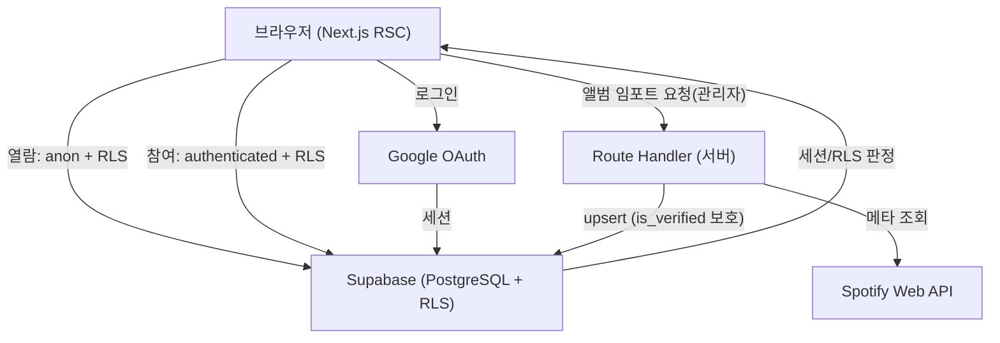

> ⚠️ **이 문서는 2026/08 피벗 시점의 기획본입니다. 실제 구현과 다릅니다.**
> 주요 차이: Spotify → 실제 MusicBrainz + Cover Art Archive / posts 통합 테이블 → 실제
> board_posts(promo·qa·update) + gallery_posts 분리 / gallery_subscriptions·notifications
> 실기능·monthly_ranking VIEW·is_admin(role) 등은 미구현(v1.1).
>
> **현재 실제 상태 참조:**
> - 스키마: [`../03_ERD.md`](../03_ERD.md)
> - 배포 상태·회귀: `08_Deployment-Checklist.md` — 레포에는 아직 없음, 이슈 [#73](https://github.com/Zpark99/ARS/issues/73)로 진행 예정
> - 기능 개요: 루트 [`README.md`](../../README.md)
> - API·아키텍처 실제: 코드(`app/api/`, `app/`)가 정본
>
> 이 문서는 "피벗 당시 계획"의 기록으로만 보존하며 정정하지 않습니다.

# System Architecture — ARS (피벗)
> ✅ 확정 · 🔶 설계 판단 · ⚠️ P1 리스크<br>선행: 03 ERD · 후행: 07 API-Spec / 08 Deployment-Checklist

---

## 0. 문서 정보 ✅

| 항목 | 내용 |
|---|---|
| 문서 버전 | v0.2 (기획-디자인 완료) |
| 작성일 | 2026/08/22 |
| 작성자 | 박진재 |
| 아키텍처 유형 | Jamstack · Next.js(App Router) + Supabase BaaS |

**변경 이력**

| 버전 | 날짜 | 변경 내용 |
|---|---|---|
| v0.0 | 08/11 | 최초 작성 |
| v0.1 | 08/20 | 로그인 구글 OAuth 확정, 갤러리 마이그레이션을 팀별 전환(galleries 폐기→artists 흡수, gallery_id→artist_id 백필)으로 재작성 |
| v0.2 | 08/22 | 문서 내용 수정 |

---

## 1. 기술 스택 ✅

| 레이어 | 기술 | 비고 |
|---|---|---|
| 프레임워크 | Next.js 14 (App Router) | RSC 기반 |
| 언어 | TypeScript | |
| 스타일 | Tailwind CSS | ARS 토큰 (Brand 색 승계 + 타이포·시맨틱 신규) |
| DB / Auth | Supabase (PostgreSQL 15 + RLS) | Auth = 구글 OAuth |
| 외부 API | Spotify Web API | 앨범·가수 메타 임포트 |
| 호스팅 | Vercel | Route Handler = 서버리스 함수 |

> 법과사전과 달리 **LLM 의존 없음** (AI 판단 기능 부재).

---

## 2. 데이터 흐름 (Data Flow) ✅

### 2.1 읽기 (열람 — 비로그인 허용)
```plain text
브라우저 (RSC) → Supabase 직접 조회 (anon key + RLS)
  · 공개 테이블(posts·albums·artists·profiles)은 anon 읽기 허용
  · 목록은 키셋 커서 페이지네이션 (1000행 한계 회피)
```

### 2.2 쓰기 (참여 — 로그인 게이트)
```plain text
클라이언트 액션 → (로그인 확인) → Supabase insert/update (authenticated + RLS)
  · RLS가 auth.uid() = author_id 강제 → 소유권 서버측 보장
  · 비로그인 시 /login(구글 OAuth) 리다이렉트 후 복귀
```

### 2.3 Spotify 임포트 (관리자·서버 전용) ⚠️
```plain text
관리자 트리거 → Next.js Route Handler (서버) → Spotify API
  → upsert albums/artists ON CONFLICT (spotify_id) WHERE is_verified = false
  · Spotify 토큰은 서버 환경변수 (클라이언트 노출 금지)
  · is_verified=true(관리자 보정) 레코드는 덮어쓰기 제외
```

> **왜 Route Handler인가**: Spotify client_secret 브라우저 노출 금지 → 서버 경유 필수. 토큰 캐싱은 서버 메모리/DB (주모 KIS 토큰 캐싱 패턴 재사용 가능).

---

## 3. 인증 · 권한 아키텍처 ✅ (구글 OAuth)

- **Auth: Supabase Auth (구글 OAuth 단일)**. 이메일/비번 없음. 세션은 쿠키.
- **게이팅 2단**:
	1. UI 게이트 — 비로그인 시 작성/좋아요(하트)/구독/팔로우 클릭 → `/login`
	2. RLS 게이트 — DB 레벨 재차 강제 (UI 우회해도 막힘)
- **관리자**: `profiles.is_admin` → 앨범 보정·공지·요청 승인. RLS에서 `is_admin` 체크.

**v1 잔여 이슈 ① auth.getUser() 401/500 혼동**<br>v1은 네트워크 에러(500)와 미인증(401)을 뭉뚱그려 처리 → "로그인 했는데 튕김" 버그.<br>대응: getUser() 실패를 (a) 미인증 → /login, (b) 네트워크/서버 오류 → 재시도·에러 UI로 명시 분기. 두 케이스를 절대 같은 코드로 처리하지 않음.

---

## 4. v1 잔여 이슈 처리 (안정화 승계) ✅

### 4.1 likes 동시성 (TOCTOU) ⚠️
- 문제(v1): check → then insert 사이 경쟁 → 중복 좋아요·카운트 깨짐.
- 대응: `UNIQUE(user_id, target_type, target_id)` + `INSERT … ON CONFLICT DO NOTHING` (토글 해제=DELETE). 체크 로직 제거로 경쟁 구간 소멸.
- 적용: 앨범 허브 헤더 하트 탭(=HOT 투표)도 동일 처리.

### 4.2 1000행 조회 한계
- 문제(v1): PostgREST 기본 1000행 → 목록 silent 절단.
- 대응: offset 금지, 키셋 커서(`where created_at < :cursor order by created_at desc limit N`). 집계(랭킹)는 VIEW + 서버 집계.

### 4.3 에러 스왈로잉
- 문제(v1): likes API가 에러를 삼켜 실패를 성공처럼 반환.
- 대응: 실패 시 명시적 throw + 클라이언트 에러 UI. 로깅 표준화.

---

## 5. 갤러리 마이그레이션 전략 ⚠️ P1 핵심 리스크

> 간트 P1(8/10~8/15)의 ★리스크. **팀별 전환**: galleries(카테고리) 미생성, `artists`가 갤러리 흡수. v1 board/gallery_posts → 통합 `posts` (gallery_id → artist_id).

| 단계 | 작업 | 안전장치 |
|---|---|---|
| 1 | 신규 스키마 생성 — `posts`, artists에 갤러리 필드 추가, `gallery_subscriptions` | 기존 테이블 유지(병행) |
| 2 | v1 데이터 백필 — board_type 매핑 + **기존 gallery_id → artist_id 매핑** | 읽기 전용 복사, 원본 보존 |
| 3 | 앱 라우팅 신규 테이블로 전환 (`/gallery/[artistId]`) | feature flag / 브랜치 |
| 4 | 검증 후 구 테이블(galleries·board) 폐기 | **롤백 = 3단계 되돌림** |

> **gallery_id → artist_id 백필이 핵심 난관**: v1 글이 카테고리(gallery_id)에 묶여 있으면, 그 카테고리를 어느 아티스트(팀)로 매핑할지 결정 필요. 매핑 불가한 레거시 글은 `artist_id = null` 허용 후 수동 정리.<br>**마이그레이션 파일 먼저 원칙** (CLAUDE.md): 파일 작성 → 커밋 → DB 적용 순. 유령 마이그레이션 금지.<br>**컷 라인 (무버퍼 대응)**: 8/17까지 미완 시 → 갤러리를 소수 팀(시드 10팀)만 수동 등록하는 MVP로 축소, P2 진행. 스키마는 확장 가능하게 유지.

---

## 6. 배포 · 환경 ✅
```plain text
GitHub → Vercel (CI/CD 자동 배포)
  · main 브랜치 = production (ars-eta-one.vercel.app)
  · 환경변수: SUPABASE_URL / ANON_KEY / SERVICE_ROLE(서버) / SPOTIFY_CLIENT_ID·SECRET(서버)
  · 구글 OAuth: Supabase Auth Provider 설정 + 리다이렉트 URL 등록
  · Route Handler = Vercel 서버리스 (실행시간 제한 고려)
```
- **CLAUDE.md 워크플로우 준수**: 기능→develop→main 3단계 브랜치. 이슈 → 브랜치 → 커밋 → PR → 질문 후 승인 시 머지.

---

## 7. 아키텍처 다이어그램 ✅


---

## 8. 리스크 · 대응 요약 ✅

| 리스크 | 대응 |
|---|---|
| ⚠️ 갤러리 마이그레이션(gallery_id→artist_id 백필) | 병행 테이블 + 롤백 4단계 + 8/17 컷라인 |
| Spotify 토큰 노출 | 서버 Route Handler 경유, 환경변수 격리 |
| API 재동기화 덮어쓰기 | is_verified 플래그로 관리자 보정분 보호 |
| likes 동시성·1000행 | unique+upsert / 키셋 커서 (§4) |
| Vercel 함수 실행시간 | Spotify 배치는 소량·페이지드 임포트 |

---

## 9. 다음 문서 연결 ✅
- **07 API-Spec**: §2 데이터 흐름 → 엔드포인트별 요청/응답 스키마.
- **08 Deployment-Checklist**: §6 환경변수·배포 + §4 잔여 이슈 회귀 테스트.
